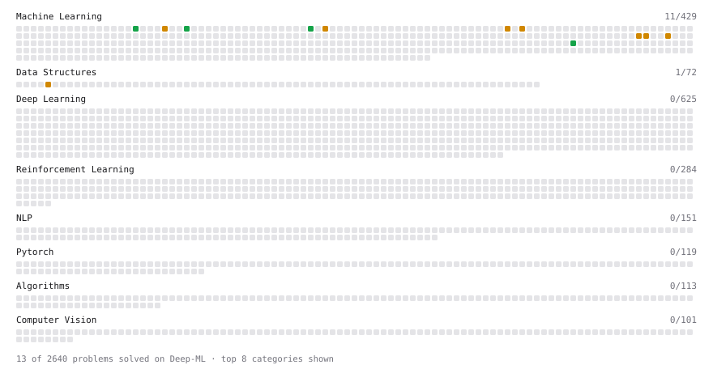

# Deep-ML

My machine learning practice from [Deep-ML](https://www.deep-ml.com). Every solution here was written by hand.

**24** solved · 15 problems · 0 labs · 9 math

[**Browse the interactive portfolio**](https://settivishal.github.io/deep-ml/) to replay this filling in over time.

## Problems

| | Difficulty | Solved | |
| --- | --- | --- | --- |
| [Balance Dataset via Undersampling](https://www.deep-ml.com/problems/1057) | easy | 2026-11-23 | [solution](problems/1057-balance-dataset-via-undersampling) |
| [Implement Early Stopping Based on Validation Loss](https://www.deep-ml.com/problems/135) | easy | 2026-11-18 | [solution](problems/0135-implement-early-stopping-based-on-validation-loss) |
| [Implement Gini Impurity Calculation for a Set of Classes](https://www.deep-ml.com/problems/64) | easy | 2026-11-23 | [solution](problems/0064-implement-gini-impurity-calculation-for-a-set-of-classes) |
| [Implement Ridge Regression Loss Function](https://www.deep-ml.com/problems/43) | easy | 2026-11-18 | [solution](problems/0043-implement-ridge-regression-loss-function) |
| [Implement Weight Decay as L2 Regularization](https://www.deep-ml.com/problems/198) | easy | 2026-11-18 | [solution](problems/0198-implement-weight-decay-as-l2-regularization) |
| [Bias-Variance Decomposition from Bootstrap](https://www.deep-ml.com/problems/804) | medium | 2026-11-18 | [solution](problems/0804-bias-variance-decomposition-from-bootstrap) |
| [Calculate AUC (Area Under ROC Curve)](https://www.deep-ml.com/problems/277) | medium | 2026-11-25 | [solution](problems/0277-calculate-auc-area-under-roc-curve) |
| [Elastic Net Regression via Gradient Descent](https://www.deep-ml.com/problems/139) | medium | 2026-11-18 | [solution](problems/0139-elastic-net-regression-via-gradient-descent) |
| [Handle Imbalanced Data with SMOTE](https://www.deep-ml.com/problems/357) | medium | 2026-11-23 | [solution](problems/0357-handle-imbalanced-data-with-smote) |
| [Implement Lasso Regression using ISTA](https://www.deep-ml.com/problems/50) | medium | 2026-11-18 | [solution](problems/0050-implement-lasso-regression-using-ista) |
| [Implement Precision-Recall Curve](https://www.deep-ml.com/problems/278) | medium | 2026-11-23 | [solution](problems/0278-implement-precision-recall-curve) |
| [Implement ROC Curve Calculation](https://www.deep-ml.com/problems/276) | medium | 2026-11-25 | [solution](problems/0276-implement-roc-curve-calculation) |
| [Learning Curve Generator for Bias-Variance Diagnosis](https://www.deep-ml.com/problems/800) | medium | 2026-11-18 | [solution](problems/0800-learning-curve-generator-for-bias-variance-diagnosis) |
| [Permutation Feature Importance](https://www.deep-ml.com/problems/812) | medium | 2026-11-25 | [solution](problems/0812-permutation-feature-importance) |
| [Polynomial Regression Fit](https://www.deep-ml.com/problems/801) | medium | 2026-11-18 | [solution](problems/0801-polynomial-regression-fit) |

## Math

| | Difficulty | Solved | |
| --- | --- | --- | --- |
| [Class Imbalance and Proper Scoring](https://www.deep-ml.com/math-problems/44) | easy | 2026-11-23 | [solution](math/0044-class-imbalance-and-proper-scoring) |
| [Model Selection: CV, AIC, and BIC](https://www.deep-ml.com/math-problems/43) | easy | 2026-11-14 | [solution](math/0043-model-selection-cv-aic-and-bic) |
| [Bias–Variance Decomposition](https://www.deep-ml.com/math-problems/39) | medium | 2026-11-14 | [solution](math/0039-bias-variance-decomposition) |
| [Covariance and Correlation](https://www.deep-ml.com/math-problems/17) | medium | 2026-11-14 | [solution](math/0017-covariance-and-correlation) |
| [Information Theory: Entropy](https://www.deep-ml.com/math-problems/24) | medium | 2026-11-17 | [solution](math/0024-information-theory-entropy) |
| [Optimization: Convexity and Critical Points](https://www.deep-ml.com/math-problems/6) | medium | 2026-11-14 | [solution](math/0006-optimization-convexity-and-critical-points) |
| [Regularization and Generalization](https://www.deep-ml.com/math-problems/31) | medium | 2026-11-14 | [solution](math/0031-regularization-and-generalization) |
| [Eigendecomposition and SVD](https://www.deep-ml.com/math-problems/16) | hard | 2026-11-17 | [solution](math/0016-eigendecomposition-and-svd) |
| [Maximum Likelihood and MAP](https://www.deep-ml.com/math-problems/26) | hard | 2026-11-17 | [solution](math/0026-maximum-likelihood-and-map) |

---

_This file is regenerated by Deep-ML on every push._
